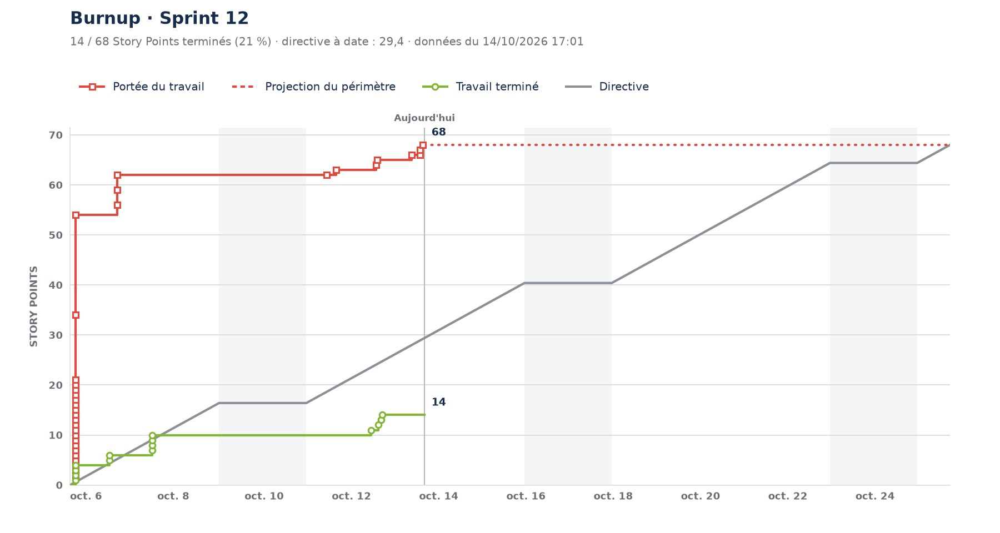

# jira-daily-report

Rapport de daily meeting généré depuis Jira Cloud, pensé pour tourner chaque matin dans une routine Claude :

- **Burnup du sprint** en JPG, redessiné à l'identique du rapport Jira (que Jira n'exporte pas) ;
- **Depuis hier** : tickets terminés, réouverts, ajoutés, retirés, ré-estimés ;
- **État du sprint** par colonne du board : epics en recette, assignés, MR/PR repérées dans les commentaires, tickets non affectés.



Exemple de rapport complet : [`examples/daily.md`](examples/daily.md) (données anonymisées).

Le tout est un [skill Claude Code](https://code.claude.com/docs/en/skills) : `.claude/skills/jira-daily-report/`.

## Configuration

| Variable | Rôle |
|----------|------|
| `JIRA_BASE_URL` | `https://votre-site.atlassian.net` |
| `JIRA_EMAIL`, `JIRA_API_TOKEN` | [jeton API](https://id.atlassian.com/manage-profile/security/api-tokens) classique (Basic auth) |
| `JIRA_BOARD_ID` | ID du board (visible dans l'URL `…/boards/<id>`) |
| `JIRA_BOARD_SECTIONS` | facultatif : rubriques de l'état du sprint, voir le [SKILL.md](.claude/skills/jira-daily-report/SKILL.md#configuration-des-rubriques) |

## Utilisation locale

```bash
uv run --script .claude/skills/jira-daily-report/scripts/daily_report.py -o burnup.jpg --report daily.md
```

Sans `uv` : `pip install matplotlib`, puis `python3 …/daily_report.py`. Pour tester sans Jira :
`--from-json examples/demo-sprint.json`.

## Routine Claude (cloud)

1. Pousser ce dépôt sur GitHub et y donner accès à Claude (GitHub App ou `/web-setup`).
2. Dans l'environnement cloud de la routine :
   - **variables d'environnement** : celles du tableau ci-dessus (lisibles par quiconque utilise l'environnement :
     garder un environnement personnel, non partagé) ;
   - **accès réseau** : `Custom`, avec `votre-site.atlassian.net` et la liste par défaut des gestionnaires de paquets ;
   - **script de setup** : `pip install matplotlib`.
3. Planifier en semaine avant le daily, par exemple `7 9 * * 1-5`, avec un prompt qui invoque le skill `jira-daily-report`.

## Limites

- Le burnup repose sur un endpoint interne de Jira (`/rest/greenhopper/1.0/…`), susceptible de changer sans préavis.
- L'état des MR/PR (ouverte, fusionnée) n'est pas connu : seuls les liens présents dans les commentaires Jira sont lus.
- Le rapport est en français.
